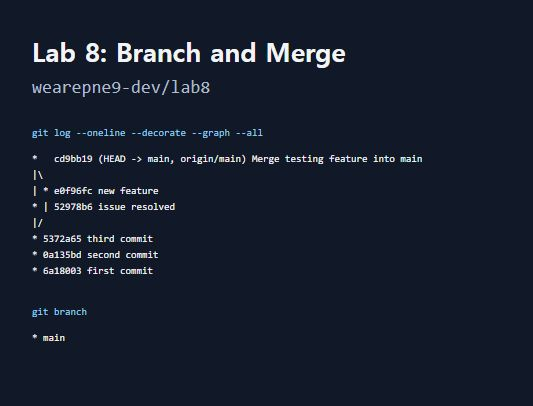

# Lab 8: Branch and Merge

Open Source SW, Lecture 8 — Git branching and merging practice.

## Practice completed

1. Initialized a new repository on `main` and created the first, second, and third commits.
2. Created `codex/testing`, switched to it, and committed `new_feature.txt`.
3. Switched back to `main`, confirmed the feature file was absent, and committed the issue resolution in `edition.txt`.
4. Merged the two diverging histories with a real two-parent merge commit.
5. Deleted the merged practice branch with `git branch -d codex/testing`.

The only remaining branch is `main`. Both practice files are present after merging.

## Submission

[Lab8.jpg](Lab8.jpg)

The image captures the real output of these commands in a local command-output viewer:

```sh
git log --oneline --decorate --graph --all
git branch
```

The screenshot was taken after the practice history was pushed and the temporary branch was deleted, before the separate submission-files commit. The same command output is preserved in [Lab8-log.txt](Lab8-log.txt).


